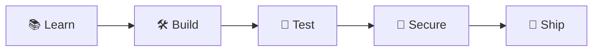

<div align="center">


<br/><br/>


<a href="https://linkedin.com/in/harijella"></a>
<a href="mailto:harijella8@gmail.com"></a>


</div>

<br/>

## 💻 `$ whoami`

```bash
hari@github:~$ whoami
Jella Haribabu | Software Developer (Fresher) 👨‍💻

hari@github:~$ cat education.txt
MCA, JNTU Anantapur

hari@github:~$ cat skills.txt
Python | Java | JavaScript | Machine Learning | Security Basics

hari@github:~$ cat mission.txt
Build clean, secure, useful software and get better with every project.

hari@github:~$ ./start_career.sh
Status: Open to fresher roles 🚀
```

## 🧰 `Tech Stack`

<div align="center">


</div>

## 🧠 `How I Work`



## 🚀 `Featured Projects`

<div align="center">

<a href="https://github.com/Harrii27/Dating-App-Dear"></a>
<a href="https://github.com/Harrii27/Brain-Tumor-Detection"></a>
<a href="https://github.com/Harrii27/Password-Strength-Analyzer"></a>

</div>

- 💘 **Dear, Dating App**: a full-stack app with login, messaging and a database (Java, HTML/CSS/JS)
- 🧠 **Brain Tumor Detection**: a CNN that classifies 4 tumor types from 500+ MRI samples (Python, TensorFlow, Keras)
- 🔐 **Password Strength Analyzer**: checks password strength using NIST guidelines (Python, hashlib, regex)

## 📊 `My Languages`

<div align="center">


</div>

## 🗺️ `Roadmap`

- [x] Completed my MCA at JNTU Anantapur
- [x] Built full-stack and machine learning projects
- [ ] Finish and publish the Password Strength Analyzer
- [ ] Keep adding projects with clear documentation
- [ ] Land my first role as a software developer 🎯

## 🎯 `What I'm Looking For`

- 💻 Software Developer / Software Engineer (fresher)
- 🐍 Python Developer or ☕ Java Developer roles
- 🛡️ Entry-level security roles where I can grow

<details>
<summary><b>🎓 Education</b></summary>
<br/>

- **MCA**, JNTU Anantapur (2023 to 2025)
- **BSc**, Sri Hari Degree College (2019 to 2023)

</details>

<details>
<summary><b>📜 Certifications</b></summary>
<br/>

- ISC2 Cybersecurity
- IBM Design Thinking
- IBM Python for Data Science
- edX Python Programming Basic Skills
- edX Object-Oriented Programming

</details>

<br/>

<div align="center">


## 📫 Let's build something together

<a href="https://linkedin.com/in/harijella"></a>
<a href="mailto:harijella8@gmail.com"></a>

</div>


