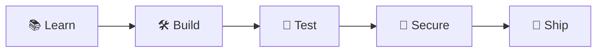

  

 

> [!TIP]
> **I'm a fresher looking for my first role as a Software Developer.** If you're hiring or want to collaborate, I'd love to hear from you!

## 👋 About Me

I'm **Hari**, a recent MCA graduate from JNTU Anantapur who loves turning ideas into working software. I learn by building real projects in Python and Java, and I care about writing clean, secure code.

| ✨ Quick Facts | |
|---|---|
| 🎓 **Education** | MCA, JNTU Anantapur |
| 📍 **Based in** | Kadapa, India |
| 💻 **Focus** | Software development and machine learning |
| 🛡️ **Also interested in** | Cybersecurity and secure coding |
| 🎯 **Looking for** | My first role as a Software Developer |

## 🧰 Tech Stack

## 🧠 How I Work

## 🚀 Featured Projects

| Project | What it does | Tech |
|---|---|---|
| 💘 **[Dear, Dating App](https://github.com/Harrii27/Dating-App-Dear)** | Full-stack app with login, messaging and a database | Java, HTML, CSS, JavaScript |
| 🧠 **[Brain Tumor Detection](https://github.com/Harrii27/Brain-Tumor-Detection)** | CNN that classifies 4 tumor types from 500+ MRI samples | Python, TensorFlow, Keras |
| 🔐 **[Password Strength Analyzer](https://github.com/Harrii27/Password-Strength-Analyzer)** | Checks password strength using NIST guidelines | Python, hashlib, regex |

## 🗺️ Roadmap

- [x] Completed my MCA at JNTU Anantapur
- [x] Built full-stack and machine learning projects
- [ ] Finish and publish the Password Strength Analyzer
- [ ] Keep adding projects with clear documentation
- [ ] Land my first role as a software developer 🎯

## 🎯 What I'm Looking For

- 💻 Software Developer / Software Engineer (fresher)
- 🐍 Python Developer or ☕ Java Developer roles
- 🛡️ Entry-level security roles where I can grow

<b>🎓 Education</b>

 

- **MCA**, JNTU Anantapur (2023 to 2025)
- **BSc**, Sri Hari Degree College (2019 to 2023)

<b>📜 Certifications</b>

 

- ISC2 Cybersecurity
- IBM Design Thinking
- IBM Python for Data Science
- edX Python Programming Basic Skills
- edX Object-Oriented Programming

---

> [!NOTE]
> 📫 **Let's connect:** [LinkedIn](https://linkedin.com/in/harijella) | harijella8@gmail.com
